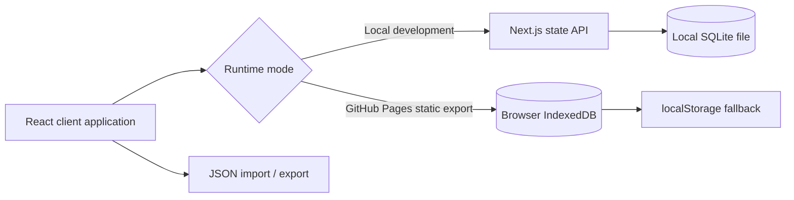

# 75 Soft Challenge

[](https://github.com/offlany/75-soft-challenge/actions/workflows/pages.yml)

A locally running, customizable 75-day challenge tracker and meal planner built with Next.js, React, TypeScript, and SQLite. The same client application can also be exported as a static GitHub Pages site with browser-only persistence.

> **Live Demo:** pending the first approved deployment. The configured target is [GitHub Pages](https://offlany.github.io/75-soft-challenge/), but this repository preparation has not deployed it yet.

The application interface is currently in Hungarian. The repository documentation is in English so the implementation and portfolio context are easy to review.

## Project overview

The project demonstrates a small full-stack-to-static migration:

- Local development uses a Next.js App Router page and a SQLite-backed state API.
- The GitHub Pages build uses the same React application and calculation logic, but replaces the server persistence path with IndexedDB and a `localStorage` fallback.
- The static build does not include the local SQLite API route, does not require Node.js at runtime, and does not send user data to a remote application server.

## Implemented features

| Area | Implementation status |
| --- | --- |
| Challenge setup | Custom start date/time, water target, active habits, rest day, skip rules, and progress-picture interval |
| Daily tracking | Movement, reading, water, mindful eating, self-care, alcohol notes, rest days, and free-form notes |
| Calendar | Interactive month calendar with challenge days, planned meals, and scheduled progress-picture events |
| Progress pictures | Scheduled dates plus local image upload stored in the application state |
| Recipes | 30 generic starter recipes, search, category filtering, custom recipe creation, favorites, deletion, preparation metadata, and instructions |
| Meal planning | Weekly breakfast/lunch/dinner assignments backed by cooking batches and serving limits |
| Grocery lists | Automatic ingredient aggregation from meal-prep batches, pantry/purchased status, and manual items |
| Data portability | JSON export and import with basic state-shape validation |
| Persistence | Local SQLite in server mode; IndexedDB with `localStorage` fallback in static mode |

## Technology

- Next.js 15 App Router
- React 19
- TypeScript
- Node.js built-in `node:sqlite` API for local server mode
- SQLite for local server-side state
- IndexedDB and `localStorage` fallback for the static browser build
- Vitest for calculation and persistence tests
- Tailwind CSS v4 PostCSS integration and custom CSS styling
- GitHub Actions, GitHub Pages, and the official Pages artifact/deployment actions

## Requirements

- Node.js 24 or newer
- npm

Node 24 is recommended because the local application uses the built-in `node:sqlite` module. No external database server is required.

## Run locally

```bash
npm ci
npm run dev
```

Open `http://localhost:3000` in a browser. The SQLite database is created automatically under `data/75-soft.sqlite` on first server start.

Useful local checks:

```bash
npm run test
npm run lint
npm run build
```

Set `SOFT_DATA_DIR` to store the SQLite file outside the repository, for example:

```bash
SOFT_DATA_DIR="$PWD/.local-data" npm run dev
```

## GitHub Pages static build

The repository includes [`.github/workflows/pages.yml`](.github/workflows/pages.yml). It validates pull requests and, after an approved merge to `main`, builds and deploys the static artifact using the official GitHub Pages actions.

Build the Pages artifact locally with:

```bash
npm run build:pages
```

This command temporarily excludes the local SQLite API route while Next.js creates the export, then restores the route before exiting. The exported application starts with a clean onboarding screen and stores each visitor's setup and progress in browser storage. The local source remains available for `npm run dev` and `npm run build`. The exported application is configured for the repository subpath `/75-soft-challenge/`, supports trailing-slash direct loading, and uses browser persistence.

The intended URL after a successful, approved deployment is:

```text
https://offlany.github.io/75-soft-challenge/
```

This preparation step has not published the repository or deployed the site, so the URL is not claimed as live yet.

## Persistence and data flow



The browser build keeps state in the current browser profile. Clearing site data, using a private browsing session, or changing browsers can remove access to that state, so use the JSON export for backups. If browser storage is unavailable, the interface shows a visible save error instead of displaying a misleading successful-save status.

## Development / testing data

The starter recipes and displayed text are generic synthetic content included to make the application reviewable without personal data. A new visitor still completes onboarding before the challenge becomes active; the starter recipes are available as an empty library, not as logged activity. They are not a production meal database and are not presented as medical or nutritional advice.

## Data and privacy

This repository intentionally excludes the original local database, progress pictures, exported JSON, and personal logs. The app can store habit, wellness-adjacent, and image data locally, so treat generated SQLite files, browser storage, and exports as private user data.

The local API has no authentication, encryption, multi-user separation, or remote synchronization. Run it on a trusted machine and do not expose it to an untrusted network without adding an appropriate access-control layer.

The GitHub Pages build is static and does not provide a shared backend. Each visitor has an independent browser-local state; no server-side synchronization is implemented.

## Limitations

- The local mode requires Node.js 24 because of the built-in `node:sqlite` API.
- GitHub Pages cannot run the local SQLite API, so the static build uses browser storage instead.
- Browser storage quotas and private-browsing restrictions can limit the size or lifetime of progress-image data.
- Imported JSON is accepted when it has the expected top-level state fields; validate backups before importing them.
- The Pages workflow must be enabled in the repository settings with GitHub Actions as the Pages source before the first deployment.
- The application interface remains Hungarian.

## License

The original application source code and repository documentation are licensed under the MIT License. See [LICENSE](LICENSE).

Third-party packages, including Next.js, React, Lucide, TypeScript, Tailwind CSS, Vitest, and their transitive dependencies, retain their own licenses. The MIT License for this repository does not relicense those packages, GitHub services, browser APIs, user-entered local data, images, exports, or generated SQLite files.
